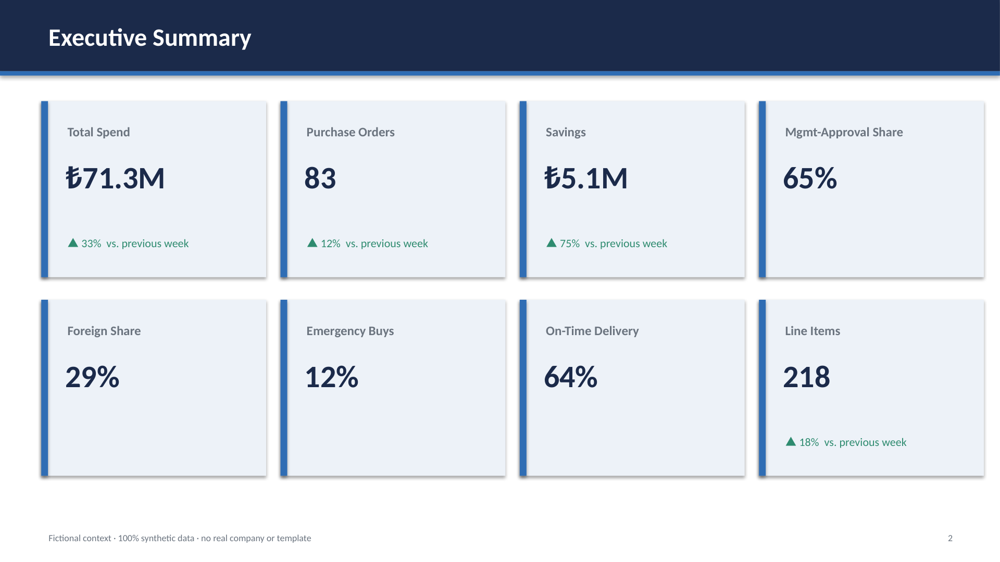
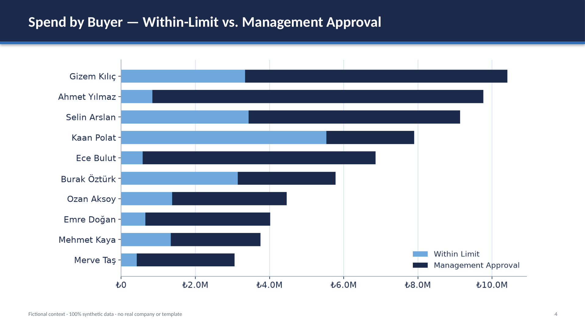
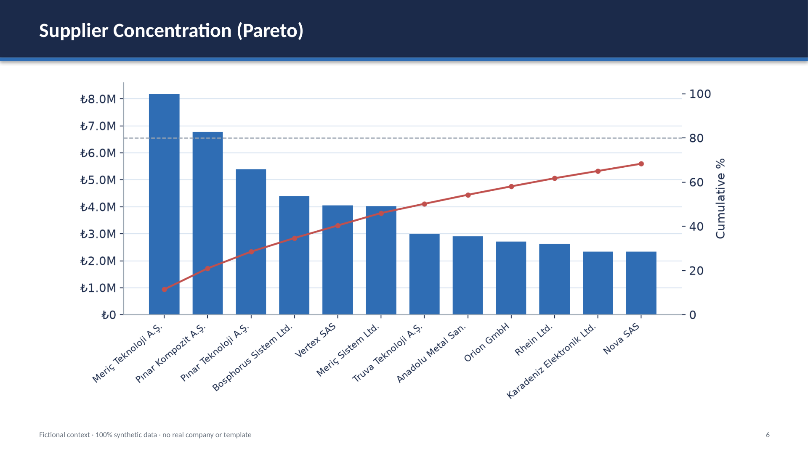
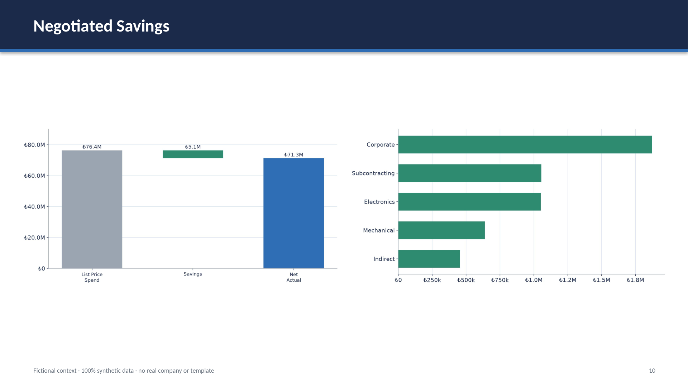
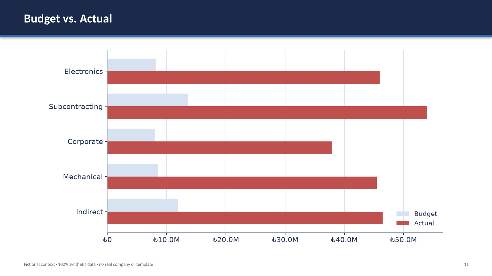
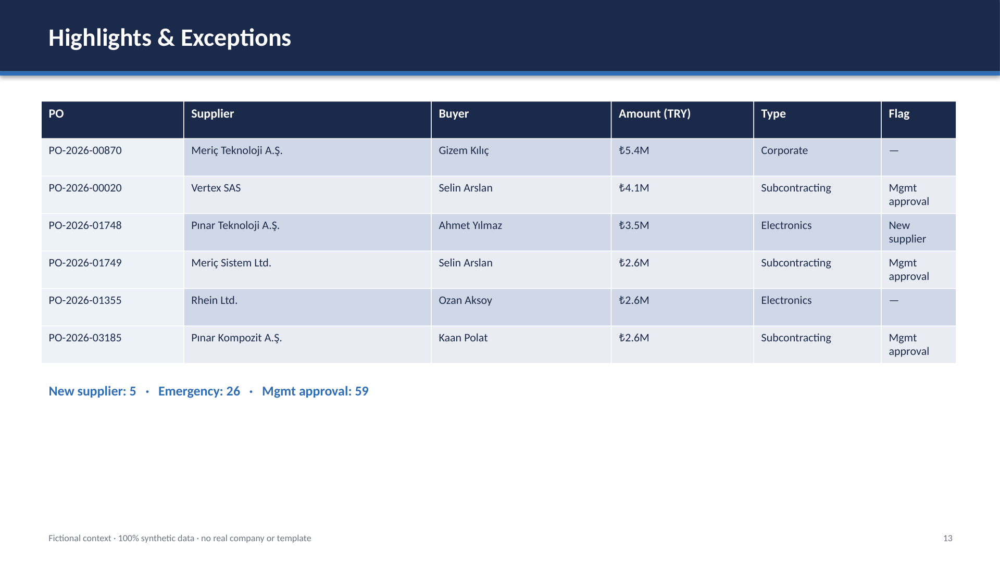

# Procurement Weekly Report Automation

Turn a procurement workbook into a **13-slide executive PowerPoint** — in one click, in English or Turkish.


> **🔗 Live demo:** _deploy in ~2 minutes on Streamlit Community Cloud — see [Deploy](#deploy). Paste your URL here once live._

---

## The case behind it

**Situation.** Procurement teams report weekly to management: how much was bought, by whom, from which suppliers, how much stayed within each buyer's approval limit vs. escalated to management, domestic vs. foreign, savings, budget adherence.

**Problem.** That weekly deck is often assembled **by hand** — an analyst pivots large spreadsheets and rebuilds the same charts every week. It is repetitive, slow, and error-prone: an estimated **3–4 hours every week (150+ hours a year)** of skilled time spent re-creating a report whose *structure never changes* — only the data does.

**Insight.** If the structure is fixed and only the data changes, the whole report is automatable end-to-end.

**Solution.** This tool ingests a procurement workbook (any week's data), applies the business rules (approval-limit logic, FX conversion, savings, budget vs. actual), and generates the full executive deck in **seconds** — bilingual, with the right visualization chosen for each metric.

**Result.** A ~3-hour manual task becomes a few-second, repeatable, consistent one — and the output is a genuine, management-ready `.pptx`, not a dashboard the reader has to interpret.

> ⚠️ **Fully synthetic.** No real company, template, or data is used. Every figure is generated by `generate_sample_data.py`. This is a portfolio demonstration built from a *process* I observed, not from any employer's data.

---

## What the deck looks like

_Real slides rendered from the generated sample report (Meridian week of 20–26 Apr 2026):_

| Executive summary | Buyer — within-limit vs. management approval |
|---|---|
|  |  |

| Supplier concentration (Pareto) | Negotiated savings (waterfall) |
|---|---|
|  |  |

| Budget vs. actual | Highlights & exceptions |
|---|---|
|  |  |

📎 **Sample output:** [`outputs/sample_report.pptx`](outputs/sample_report.pptx)

---

## Features

- **Any week in, deck out.** Upload a workbook, pick a week, download the report. The tool is not hard-wired to one file — it validates and processes whatever conforming workbook you give it.
- **13 slides, each with the right visual** — KPI cards, stacked bars, a Pareto, donuts, a YTD trend line, a savings waterfall, budget-vs-actual, a risk panel, and a highlights table.
- **Business rules in code**, not baked into the data: approval type is derived from each buyer's limit; every line is converted to TRY using the date-appropriate FX rate; savings, lead-time and on-time-delivery are computed.
- **Bilingual (EN / TR)** — both the interface and the generated report; report language is independently selectable, English by default.
- **Robust input handling** — schema validation with clear, user-friendly errors, plus EN/TR column-header mapping.

---

## How it works

```
             ┌────────────┐   ┌───────────┐   ┌──────────┐   ┌────────┐
 workbook →  │  parsing   │ → │  metrics  │ → │  charts  │ → │  deck  │ → report.pptx
   .xlsx     │ validate + │   │ enrich +  │   │ matplotlib│  │ python-│
             │ TR/EN map  │   │ aggregate │   │  images   │  │  pptx  │
             └────────────┘   └───────────┘   └──────────┘   └────────┘
                          report_generator/  (pure logic)      app.py (Streamlit shell)
```

- **`parsing.py`** — loads the workbook, validates the 6 sheets & required columns, maps English headers to canonical ones, coerces types. Raises friendly `ValidationError`s.
- **`metrics.py`** — joins the sheets, converts to TRY (nearest-date FX), **derives** approval type from limits, computes savings / lead-time / OTD, then builds every aggregation for the selected week with previous-week and year-to-date context.
- **`charts.py`** — one consistent executive design system (navy + blue palette); every visual rendered with matplotlib.
- **`deck.py`** — assembles the 13 slides; titles, KPI cards and the highlights table are native PowerPoint shapes, charts are embedded images.
- **`app.py`** — a thin Streamlit shell wiring the UI to the pipeline.

### Input data model (6-sheet workbook)

| Sheet | Purpose | Key fields |
|---|---|---|
| **Satın Almalar** | Transactions (fact table) | PO/PR, dates, buyer & supplier codes, category, qty, unit/list price, amount, currency, payment method, status, urgency |
| **Tedarikçiler** | Supplier master | code, name, country, domestic/foreign, segment |
| **Sorumlular & Limitler** | Buyer master | code, name, department, **purchase type**, **approval limit** |
| **Ödeme Yöntemleri** | Payment method master | code, method, term (days) |
| **Kur Tablosu** | Daily FX rates | date, currency, TRY rate |
| **Bütçe** | Monthly budget | period, purchase type, budget (TRY) |

### The 13 slides

Cover · Executive Summary (KPI cards) · Spend by Purchase Type · Buyer — Within-Limit vs. Management Approval · Approval Type · Supplier Pareto · Domestic/Foreign · Category & Payment · YTD Trend · Savings (waterfall) · Budget vs. Actual · Risk (concentration + FX) · Highlights & Exceptions.

---

## Getting started

```bash
# 1 · set up
python3 -m venv .venv && source .venv/bin/activate
pip install -r requirements.txt

# 2 · (optional) regenerate the synthetic sample workbook
python generate_sample_data.py           # -> data/sample_procurement_2026.xlsx

# 3 · run the app
streamlit run app.py
```

Then: upload a workbook (or keep the bundled sample) → pick a week → choose the report language → **Generate report** → download the `.pptx`.

### Tests

```bash
pytest -q      # business rules, FX conversion, validation, bilingual deck build
```

---

## Deploy

The live demo runs free on **Streamlit Community Cloud** (public repos only — no card, no cost):

1. Push this repo to GitHub (public).
2. Go to [share.streamlit.io](https://share.streamlit.io) → sign in with GitHub.
3. **New app** → pick this repo → main file `app.py` → **Deploy**.
4. Paste the resulting URL into the _Live demo_ line at the top of this README.

The bundled `data/sample_procurement_2026.xlsx` means the app is fully usable on first load — visitors need not upload anything.

---

## Tech stack

Python 3.11 · Streamlit · pandas · openpyxl · python-pptx · matplotlib · pytest

## License

[MIT](LICENSE) © 2026 Talha Uzun
